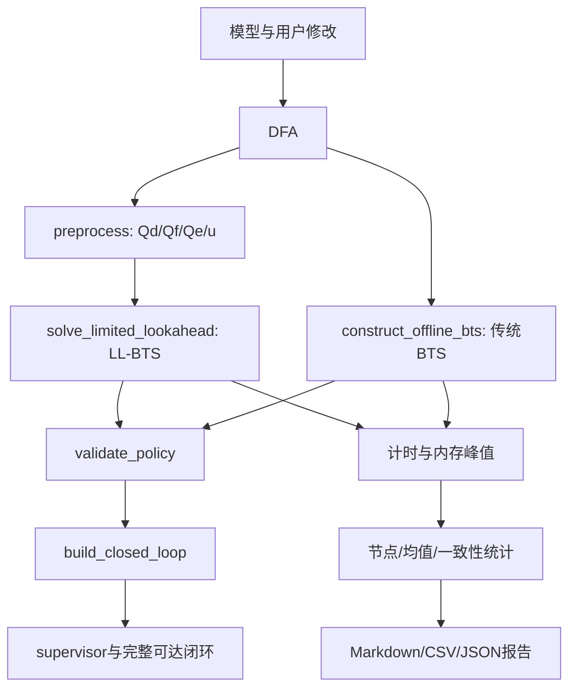

# 每一个例子如何运行

以下命令均在项目目录 `D:\__Workspace\Pycharm\des_common\limited_lookahead_deadlock_free` 中执行。使用同一个 Python 环境安装依赖和运行脚本：

```powershell
python -m pip install -r requirements.txt
```

## 单独重跑一个现有例子

当前项目已经保存61例的模型、采用u和测量数据。指定目录名即可重跑其中一个例子的online/offline综合、计时与内存测量，并重新导出offline BTS及闭环；其余例子的测量记录保留：

```powershell
python -X utf8 compare_online_offline.py --only 20CDC2_fig_2b --repetitions 11
python -X utf8 write_benchmark_review.py
```

把 `20CDC2_fig_2b` 替换为 `outputs/expanded_yin_benchmark/` 中目标例子的目录名，例如 `14IFAC_fig_1` 或 `16WODESmax_fig_3a_Gprime`。`--only` 使用已经保存的 `plant.json` 和 `preprocessing.json` 中的采用u，**不会重新读取模型构造器、扫描最小u或刷新online闭环图**。需要刷新online闭环图时另运行 `python -X utf8 draw_closed_loops.py`，该绘图入口会处理整组例子。修改模型源码后，应先执行下一节的对应模型生成命令。

输出位于 `outputs/expanded_yin_benchmark/<例子名>/`：

| 文件 | 内容 |
| --- | --- |
| `plant.json` | 本次使用的plant及事件划分 |
| `preprocessing.json`、`ll_bts.json` | 预处理、采用u和online LL-BTS |
| `closed_loop_system_online.json/png` | online闭环及图；可解时生成实际闭环 |
| `offline/bts.json` | 传统完整offline BTS |
| `offline/closed_loop_system_offline.json/png` | offline闭环及图；可解时生成实际闭环 |
| `online_offline_comparison.json` | 时间、内存、节点规模及原始重复测量 |

总表在 [运行结果.md](outputs/expanded_yin_benchmark/运行结果.md)，并排图入口为 [online_offline_index.html](outputs/expanded_yin_benchmark/online_offline_index.html)。losing例子没有可用的无死锁闭环，应查看其判定说明。

## 从模型源码重新生成全部61例

按以下顺序执行。第一步生成58个论文改编模型，第二步生成3个结构模型；后续步骤导出闭环、重新测量并更新总表：

```powershell
python -X utf8 expanded_yin_benchmark.py
python -X utf8 structural_benchmark.py
python -X utf8 draw_closed_loops.py
python -X utf8 compare_online_offline.py --repetitions 11
python -X utf8 write_benchmark_review.py
```

`expanded_yin_benchmark.py` 需要本项目 `__ref/yin2016/` 中的来源PDF和目录记录；代码审阅压缩包不包含这些资料。该脚本重新扫描u；`draw_closed_loops.py` 同时处理项目自带配置。目前这两个生成入口不提供 `--only` 参数。

## 论文例子、大乘积和随机实验

下面各入口独立运行，按需要选择：

| 目标 | 命令 | 结果目录 |
| --- | --- | --- |
| 论文图小例子的u=5/u=6、当前/旧图分量及八副本实验 | `python -X utf8 rerun_paper_examples.py` | `outputs/paper_examples_rerun/` |
| 两个千万状态论文乘积的组合式综合与验证 | `python -X utf8 revised_large_products.py` | `outputs/expanded_yin_benchmark/large_systems/` |
| 1,000个随机自动机，固定种子20261121 | `python -X utf8 randomized_online_offline.py --samples 1000 --repetitions 5 --seed 20261121` | `outputs/expanded_yin_benchmark/randomized_comparison/` |

论文重跑入口会执行其内置的整组配置；大乘积入口采用分量supervisor的组合式证明，未显式构建完整全局BTS。运行入口和证明范围的详细说明见下文第7节。

# 代码审阅说明 / Code Review Guide

本说明对应当前 limited_lookahead_deadlock_free 项目。建议先核对模型和问题语义，再检查认证条件，最后看性能实验。输出中的 winning 只针对无死锁目标，不自动意味着标记非阻塞、公平性或原论文的保密/收益目标。

## 1. 推荐阅读顺序

1. [des_core/automata.py](des_core/automata.py)：确认DFA的状态、事件、控制/观测划分和转移数据。
2. [examples/non_deadlock.py](examples/non_deadlock.py)、[examples/review_amendments.py](examples/review_amendments.py)：确认实际运行的模型版本。
3. [des_core/certified_lookahead.py](des_core/certified_lookahead.py)：依次读 preprocess、limited_ur、limited_nx、limited_choice、complete_choice、solve_limited_lookahead、Limited_Lookahead_Controller、validate_policy。
4. [des_core/offline_bts.py](des_core/offline_bts.py)：检查传统BTS是否独立构建、是否包含完整UR/NX与全部控制模式。
5. [des_core/closed_loop.py](des_core/closed_loop.py)：检查supervisor的观测更新和实际闭环。
6. [compare_online_offline.py](compare_online_offline.py)、[randomized_online_offline.py](randomized_online_offline.py)：核对计时、内存与选择u的方法。
7. [graph_size_metrics.py](graph_size_metrics.py)、[comparison_averages.py](comparison_averages.py)、[complexity_memory_report.py](complexity_memory_report.py)：核对数字和复杂度口径。
8. [rerun_paper_examples.py](rerun_paper_examples.py)：核对论文图、当前代码及历史运行器是否混用。

## 2. 当前认证实现的调用关系



## 3. 模型与预处理

| 检查对象 | 实现 | 应核对的内容 |
| --- | --- | --- |
| 部分定义DFA | automata.DFA | 同一状态、同一事件至多一个后继；初始状态和转移端点在Q内；事件属于Σ |
| 数据不可变 | DFA.__post_init__ | 复制转移映射并包装为只读，避免外部修改使索引失效 |
| 原始论文转录 | yin2016.py、yin_literature.py、yin_extended.py | 原始构造器在转成字典前检查重复键；不是用字典覆盖来掩盖非确定性 |
| 用户修订 | review_amendments.py | 删除/反向/改标签前验证原边；新增边前检查同状态同事件尚未定义；原始设计可由amended=False读取 |
| 结构测试 | structural.py | 长单链、链接环再接出口链、嵌套环；有限终止链可以合法但无死锁目标不可解 |
| 自动检查 | audit_dfa_models.py | 原始64例与当前61例的确定性、端点、划分及未定义事件检查 |

preprocess的Qd是没有后继的状态。Qf是沿单一后继状态链通往Qd的充分失败证书，不等于完整综合的全部必败状态。Qe是不能到达plant死锁的状态集合；允许全部事件即可维持其安全性。

全局候选入口包含初始状态和可观事件到达状态。深度计算枚举相关不可观测简单路径，使用当前路径标记和回溯；不是把有环图中的任意长路径当作有限深度，也不是以最短BFS距离代替最长简单路径。最坏时间可能为阶乘级，路径栈空间仍可线性。

## 4. LL-BTS认证需要逐项确认

| 位置 | 必须满足的条件 |
| --- | --- |
| limited_ur / limited_nx | 严格按论文计算UR与窗口的交集，再从截断后的x计算单事件NX与窗口的交集 |
| limited_choice | 调用两个局部算子构建D-O-D分支；NX的输入是局部UR结果 |
| complete_choice | 独立计算完整UR/NX，用于安全认证、执行及验证；局部截断结果不能直接替代真实估计 |
| solve_limited_lookahead | UR中的每个实际状态都有允许出边；不可控事件不能被禁用 |
| 窗口边界 | 窗口外行为只有被已有Qe证书覆盖时才能接受；否则记录边界，不能直接判good |
| 不确定性 | 普通剪枝失败但乐观边界仍可能获胜时返回inconclusive，不能返回losing |
| Qe终端 | 以允许全部事件的隐式安全延续停止展开；单D节点不表示plant只有一个状态 |
| count-pruning | 维护选择数和反向后继关系，剪除无可继续模式的估计并向前驱传播 |
| maximal_patterns | 返回当前初始估计的包含极大控制模式，不宣称完整全局语言的最大宽松supervisor |
| Limited_Lookahead_Controller | 观察更新使用NX对应的完整估计，保留已认证延续；不以真实物理状态重置部分观测估计 |

应特别检查：一个u能够认证winning，不表示它已经恢复offline的全部初始极大模式。论文图的小例子中，u=5只认证初始模式{a,o2}，u=6才恢复{a,b,o2}。其原因和六步路径在重跑报告及活动LaTeX中均有说明。

本次实现以 `limited_choice` 构建局部分支，另以完整后继验证其可执行性。精确公式 `UR_gamma(x_hat) ∩ x_L` 只限制终点；路径可能离开窗口又返回，因此不能直接用诱导子图内的可达集替代，也不能把本实现的UR成本宣称为纯窗口内搜索。[正确性验证记录](outputs/limited_lookahead_correctness/validation.json) 包含61例、1,000个已保存随机系统以及4例旧采用u与新匹配深度的差异；旧性能测量尚未重跑。

## 5. Offline基线与闭环导出

[offline_bts.py](des_core/offline_bts.py) 直接把完整DFA视为已知。对每个估计、每个可控事件子集计算完整UR/NX，包含不安全分支，先建完整BTS再剪枝；不用Qf/Qe或u提前终止。它与online共用DFA数据结构、结果类型和验证接口，但构建过程独立。

UR与NX已拆开：traditional_ur(plant,estimate,pattern)沿允许的不可观事件走零步或任意多步，直到不再发现状态。traditional_nx(plant,states,observable_event)只对一个指定可观事件走一步；多个可能源状态可以产生多个目标，但不会连续走多个可观事件，也不会自动再求UR。

traditional_ur_nx保留为组合接口：先UR，再按每个允许的可观事件分别得到NX结果。内部批处理仅为了用一次边扫描生成这些独立结果，不表示一次NX走了多个可观事件。得到新的决策估计后，下一次选择控制模式，再计算新的UR。

[closed_loop.py](des_core/closed_loop.py) 从保留模式固定选取一个策略，闭环节点是（实际DFA状态，控制器记忆）。不可观事件保持记忆不变，可观事件按完整估计更新。执行控制器只依赖记忆和观察，真实物理状态只用于计算和验证闭环。

每个winning例子必须检查全部可达闭环节点，而不只是一条轨迹。losing表示已证明无解；inconclusive、超时或预算不足表示未完成证明。不能把后三者当成offline/online都无解。

当前文件约定：online为 closed_loop_system_online.*；offline为 offline/closed_loop_system_offline.*。单个原始plant状态、信息节点D/O、supervisor记忆和闭环状态分别统计。

## 6. 实验与报告模块

| 实验入口 | 数据与比较目标 | 应检查的口径 |
| --- | --- | --- |
| expanded_yin_benchmark.py | 当前58个论文改编模型 | 扫描u=0…n−1，分别记录最小判定与根极大模式匹配深度；标定使用offline作对照 |
| structural_benchmark.py | 3个结构测试 | 不混为论文原例；与论文结果合计61例 |
| compare_online_offline.py | 61例、每例11次交替新鲜求解 | 主表是单例中位数；online包含预处理；公共输入、u标定、绘图和验证不计时 |
| randomized_online_offline.py | 1000例、每例5次，seed=20261121 | 指定三层随机分布；online仅按inconclusive加深，不用offline模式选择u；总体是等权算术平均 |
| graph_size_metrics.py | 构建/保留D和O | N=D+O；合计节约率为总数差÷offline总数，不能取逐例百分比均值 |
| comparison_averages.py | 中位数均值、原始671次均值、峰值均值 | 三种均值分开；结果一致性从两侧保存状态读取 |
| complexity_memory_report.py | 理论参数和编码假设 | 抽象工作量W、槽数、假定紧凑编码字节均不是实测运行时间或Python峰值 |
| write_benchmark_review.py | 两份中文审阅/结果Markdown | 保存66段用户修改意见；总表英文对照行是合法Markdown的第一条表体行 |
| benchmark_review_results.py、review_large_analyses.py | 表格、说明与大系统结果 | 可解性与根模式一致性分开；不把分量图规模当作全局BTS规模 |

内存使用两次独立tracemalloc峰值测量，online计入预处理。共同已建DFA和不可变索引不计；不等于进程RSS，不覆盖所有C扩展分配。平均峰值是各例峰值的平均，不是某一时刻同时运行的平均内存。

负值是Offline−Online的差值或节约率为负，表示online成本更高。当前61例有14例负时间节约、0例负内存/节点节约；随机1000例中有170例负内存节约，均保留。

随机1000例的可解性判定全部相同，根极大模式只有991例一致。其主要比较目标是无死锁supervisor的存在性，不能把平均性能结果写成全部最大宽松策略相同。

## 7. 大系统与论文例子

[asynchronous_product.py](des_core/asynchronous_product.py) 给每个分量事件加下标，单事件只更新其所属坐标。乘积保留各分量的控制/观测划分，未把全部事件改成可观或不可控。

[revised_large_products.py](revised_large_products.py) 完整验证一个分量的认证supervisor，再利用独立索引字母表证明整个异步乘积无死锁。代码输出精确因子化闭环，另做1/2/3副本穷举及大乘积实际轨迹检查。它不显式枚举全局BTS，也不声称已经扫描全局最小u。

论文重跑的入口为 [rerun_paper_examples.py](rerun_paper_examples.py)，模型版本位于 [paper_example_models.py](paper_example_models.py)：

- 论文图小例子的q10→q6为o2，当前项目代码为o1；两版独立运行，不擅自改动原有项目模型。
- 分量旧图q2→q0为o1，用户已将当前代码改为a；旧图分量完整offline为losing，当前分量为winning。
- u=5与u=6的认证结果、当前/旧图分量、八副本历史运行和认证预算分别保存。
- 历史运行完成50次物理根查询，不作为部分观测完整supervisor的证明。
- 当前八副本另有完整枚举验证的常量策略闭环，以及认证分量supervisor的精确组合式闭环；预算截断与可行性证明分开报告。

继续组合式计算得到：可达物理状态为4^8=65,536，含控制器记忆的闭环为8^8=16,777,216个状态对、150,994,944条转移；控制器可能记忆配置为3^8=6,561。保存的是精确因子化描述，没有显式生成上千万行转移表。局部分量全部状态/转移的检查与独立字母表给出整体证明；1/2/3副本穷举和导出控制器100,000步运行是额外验证。

从q0开始的单次固定窗口求解中，u=5保守地排除初始b，得到{a,o2}，完整6状态/7边闭环已认证无死锁；u=6恢复offline初始极大模式{a,b,o2}。安全保证针对认证策略，不能只凭u=5就任意选择控制。

若假设初始允许b，第一次o1后的完整估计是{q6,q8,q11}，并不能确定实际在q8。更新控制模式为允许a、禁用b/o2后，UR为{q6,q7,q8,q9,q10,q11}；围绕这个新估计重新建u=5窗口已经包含q10，实测结果winning。solve_limited_lookahead同次调用只建立一次窗口，而观察后再次调用会重新建窗；因此不能把“初始固定窗口需u=6匹配offline”说成“滚动重规划必须u=6”。

[sync_paper_example_results.py](sync_paper_example_results.py) 先备份，再同步活动主文case study和新图。main_original.tex与__paper归档保持不变。

结果入口：[PAPER_EXAMPLES_RERUN.md](outputs/paper_examples_rerun/PAPER_EXAMPLES_RERUN.md)。

## 8. 历史实现的范围

des_core/ll_bts.py、ll_bts_synthesis.py、control_reduction.py、factored_synthesis.py、implicit_product.py和case1_product_benchmark.py保留用于旧绘图与旧物理根查询的复现。有限窗口中的pending、单条成功轨迹和压缩控制模式族的O数量，不能替代当前完整估计的安全认证或完整显式BTS节点计数。

des_dfa_on_the_fly.py默认main已转到认证基准；其中main_example2_partial等具名绘图入口仍属于历史绘图路径。审阅时应跟随具体入口，不只看文件名。

## 9. 建议运行的核对命令

在项目目录执行：

```powershell
python -X utf8 -m unittest discover -s tests -q
python -X utf8 audit_dfa_models.py
python -X utf8 compare_online_offline.py --refresh-report --repetitions 11
python -X utf8 write_benchmark_review.py
```

需要重新测量时再执行：

```powershell
python -X utf8 compare_online_offline.py --only 20CDC2_fig_2b --repetitions 11
python -X utf8 randomized_online_offline.py --samples 1000 --repetitions 5 --seed 20261121
python -X utf8 rerun_paper_examples.py
```

第一组报表脚本依赖现有outputs中的测量/模型数据；代码审阅压缩包不包含这些输出。原始模型构造、核心单元测试可直接从源码检查。

## 10. 审阅记录建议

- 模型标签和论文图是否相同？若不同，是否有明确变体和原始快照？
- 是否存在同状态同事件多后继，或者把eps事件误当成数学ε转移？
- UR/NX是否完整，窗口外是否有有效证书？
- losing是否为证明结论，而不是预算不足？
- 控制更新是否只依赖观察历史，未读真实物理状态？
- 每个可达闭环状态是否有允许事件，所有不可控事件是否保留？
- 比较的是可行性、根极大模式还是完整语言？是否明确区分？
- 时间是否计入online预处理与窗口重试？内存是否是同口径的独立峰值？
- D/O、Plant、控制器记忆、闭环规模及构建/保留节点是否分开？
- 随机分布、种子、重复次数、未完成例子和负节约是否完整报告？
- 组合式证明是否依赖独立索引字母表？是否误称为全局显式BTS综合？

当前源码审阅快照：[code_review_bundle.zip](outputs/code_review/code_review_bundle.zip)。压缩包中的CODE_MANIFEST.json给出每个文件的SHA256和行数，便于对照审阅版本。
